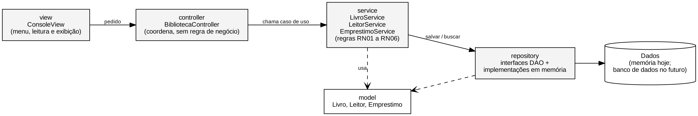

# BiblioTech - Sistema de Biblioteca

Projeto da disciplina de **Engenharia de Software** (Uniube, ADS, prof. Clênio Silva).

**Equipe:** Bryan Ferreira Santos (RA 5180226) e Rodrigo Rodrigues (RA 5183337)

O BiblioTech controla o acervo de uma biblioteca: cadastro de livros e leitores, pesquisa, empréstimos, devoluções com multa por atraso e relatório de atrasos.

## Como executar

Pré-requisitos: Java 17 ou superior e Maven.

```bash
mvn test                                                    # roda os 14 testes unitários
mvn compile
java -cp target/classes br.uniube.biblioteca.App            # abre o menu do sistema
```

## Arquitetura em camadas

```
View (ConsoleView) -> Controller (BibliotecaController) -> Service (regras) -> Repository (DAO) -> Dados
                                                     \-> Model (Livro, Leitor, Emprestimo)
```



| Camada | Pacote | Responsabilidade |
|---|---|---|
| View | `view` | Mostra o menu, lê o que o usuário digita e exibe a resposta |
| Controller | `controller` | Recebe o pedido, chama o Service e traduz erros em mensagens. Não tem regra de negócio |
| Service | `service` | Casos de uso e regras de negócio (RN01 a RN06) |
| Repository | `repository` | Interfaces DAO e implementações em memória |
| Model | `model` | Entidades do domínio |

**Decisão arquitetural:** as regras ficam só no `EmprestimoService`, e o acesso a dados fica atrás de interfaces (`LivroRepository`, `LeitorRepository`, `EmprestimoRepository`). Assim, para trocar a memória por um banco de dados basta criar outra implementação das interfaces, sem mexer nas regras nem na tela. Isso também deixa o Service fácil de testar.

## Regras de negócio

- **RN01:** no máximo 3 empréstimos ativos por leitor.
- **RN02:** prazo de devolução de 7 dias.
- **RN03:** multa de R$ 1,00 por dia de atraso.
- **RN04:** leitor com empréstimo em atraso não pode pegar novo livro.
- **RN05:** ISBN único. **RN06:** CPF único.

## Documentação

- Backlog com as User Stories: [docs/BACKLOG.md](docs/BACKLOG.md)
- Diagramas UML: [docs/diagramas](docs/diagramas)
- Protótipo de telas: [docs/prototipo](docs/prototipo)

## Estrutura

```
src/main/java/br/uniube/biblioteca/
  App.java
  model/        Livro, Leitor, Emprestimo
  repository/   interfaces DAO + implementações em memória
  service/      LivroService, LeitorService, EmprestimoService
  controller/   BibliotecaController
  view/         ConsoleView
  exception/    RegraNegocioException
src/test/java/br/uniube/biblioteca/service/
  EmprestimoServiceTest (8), LivroServiceTest (3), LeitorServiceTest (3)
```
